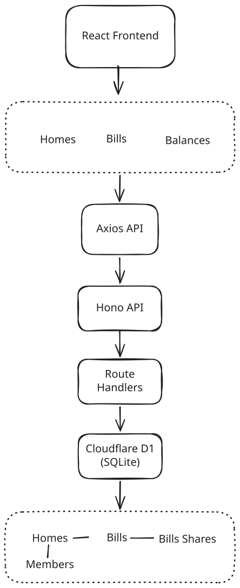

# SDE Intern Assignment: Shared Bill Splitter

Welcome. In this assignment you build a small bill splitter for a shared home. It has two parts:

1. **Homes and members:** create a home and add members to it.
2. **Bill splitting:** split a bill between the members. Each member pays their own share.

The assignment is small on purpose. We want correct, safe, and clear code. We do not want many features.

## What we look at

- **Your code passes the tests.** The tests decide, not opinion. You get the visible tests. We also run extra tests that you do not see.
- **Your code is safe when things go wrong.** Wrong input, repeated requests, and two requests at the same time must not break your data.
- **Your code is typed.** Use TypeScript. Do not use `any`.
- **You understand your code.** You record a short video and explain it.

Take your time. A careful, correct solution is better than a fast one. We expect 2 to 3 days of real work.

## Stack (required)

- **API:** Hono on Cloudflare Workers
- **Database:** Cloudflare D1 (SQLite). The binding is `DB` in `api/wrangler.jsonc`.
- **Web:** React, Vite, TanStack Router
- **Language:** TypeScript on both sides
- **Tests:** Vitest, running inside the Workers runtime
- **Quality:** Biome. `pnpm check` and `pnpm typecheck` must pass.

You choose the rest (styling, form library, validation library). Pick tools you can explain.

## The task

The assignment has two parts. Do Part 1 first. Part 2 builds on it.

**Database.** Write the schema as SQL migration files in `api/migrations/`. For example `0001_init.sql`. The tests apply every file in this folder. Your schema must have **at least 3 named constraints** that protect the data. For example a foreign key, a `CHECK`, or a `UNIQUE` key. Be ready to explain what each constraint stops.

**Errors.** Every error response is JSON: `{ "error": "message" }`.

## Part 1: Homes and members

Create a home and add members to it. The order in which members are added matters in Part 2.

#### `POST /api/homes`

- Request: `{ "name": string }`
- Success: `201` `{ id, name }`

#### `POST /api/homes/:homeId/members`

- Request: `{ "name": string }`
- Success: `201` `{ id, homeId, name }`
- Errors: `404` home not found

Visible tests: `api/test/homes.test.ts`.

## Part 2: Bill splitting

Add a bill to a home, split it between the members, and let each member pay their share.

All amounts are whole **cents** (integers). `100` cents is 1 dollar. Never use decimals for money.

#### `POST /api/homes/:homeId/bills`

- Request: `{ "title": string, "totalCents": number }`
- Success: `201` `{ id, homeId, title, totalCents, shares: [{ id, memberId, amountCents, paidAt: null }] }`
- Errors: `404` home not found. `422` total is not a positive whole number, or the home has no members.

#### `POST /api/bills/:billId/shares/:shareId/pay`

- Request: header `Idempotency-Key`
- Success: `200` `{ id, memberId, amountCents, paidAt }`
- Errors: `400` key missing. `404` bill or share not found. `409` share already paid with a different key.

#### `GET /api/homes/:homeId/balances`

- Success: `200` `{ balances: [{ memberId, name, outstandingCents }] }`
- Errors: `404` home not found

**Rules**

- **Split.** A bill is split between all members of the home. The shares always add up to `totalCents`. If the amount does not divide evenly, the extra cents go to the members one by one, in the order the members were added to the home. Example: 1000 cents between 3 members gives `334`, `333`, `333`.
- **Pay.** Paying marks one share as paid and sets `paidAt`. If the same `Idempotency-Key` is sent again for the same share, answer `200` with the same result. Do not pay twice. If two requests pay the same share at the same time, only one may succeed.
- **Balances.** `outstandingCents` is the sum of the member's unpaid shares, across all bills of the home. List the members in the order they were added.

Visible tests: `api/test/bills.test.ts` and `api/test/payments.test.ts`.

#### Web page

Build one page that:

- shows the bills of a home and the shares of each bill,
- lets a member pay a share,
- shows clear **loading**, **empty**, and **error** states,
- keeps the share unpaid and shows an error if the payment fails.

The page must not crash when the API answers with an error or is slow.

## Cases you must handle

You must handle these cases and talk about them in your video:

1. A home with no members.
2. An amount that is zero, negative, or not a whole number.
3. An amount that does not divide evenly.
4. The same payment request sent twice.
5. Two members paying the same share at the same time.
6. A bill or share that does not exist.
7. The API answers with a 500 error or is slow. The web page must not crash.

## Run it

This is a pnpm workspace. Install once at the root.

```bash
pnpm install
pnpm dev          # api on :8787 and web on :5173
```

Open http://localhost:5173. The starter page shows a title. `/api/health` returns `{ "status": "ok" }`.

```bash
pnpm test         # run the visible tests in api/test
pnpm check        # Biome: format and lint. Must pass.
pnpm check:fix    # fix what Biome can fix
pnpm typecheck    # tsc on both packages. Must pass.
pnpm build        # production build of the web app
```

`pnpm dev` applies your migrations to a local database before it starts the API.

If pnpm says some build scripts were ignored, run `pnpm approve-builds` and allow `esbuild` and `workerd`.

When you change `api/wrangler.jsonc`, refresh the `Env` types:

```bash
pnpm --filter bill-splitter-api cf-typegen
```

## Rules for the tests

- The visible tests are in `api/test`. They start with a failing result. Your job is to make them pass.
- Do **not** change the visible tests or `api/test/helpers.ts`. We compare them with the original.
- We run extra tests after you submit. They test the cases in "Cases you must handle" more closely.

## AI policy

You can use AI tools. Tell us which ones and where in your answers on the form.
You must understand every line you submit. We check this with your video and in a live call. "The AI wrote it" is not an answer.

## How to submit

1. Click **Use this template**, then **Create a new repository**. Make the repository **public**.
2. Build your solution in your new repository. Small, clear commits are welcome.
3. Update this README with a short section called **Decisions**. Write 3 decisions you made and why.
4. Record a video of **3 minutes or less** (Loom or unlisted YouTube). Show the architecture, the data flow, and one trade-off you made. Make sure anyone with the link can view it.
5. Paste the repository link and the video link in the application form.

We will run `pnpm install && pnpm check && pnpm typecheck && pnpm test` on your repository.

## Engineering Decisions

### 1. Relational database schema designed around the core entities

I started by sketching the database schema on paper before implementing the API. I identified four main entities: `homes`, `members`, `bills`, and `bill_shares`.

I also saw helpers.ts for reference

- A home can have multiple members.
- A home can have multiple bills.
- Each bill has multiple shares, one for each member.
- Each share tracks its amount and payment status independently.

I chose this structure because bills and payments need to be tracked at the individual member level, rather than storing everything inside a single bill record.

### 2. Store money as integer cents, not floating-point values

I chose integer cents (`total_cents` and `amount_cents`) instead of floating-point values for monetary calculations.

also there is a mention to not use decimals so this approach

I simplify 1 dollar to 1 rupee so its easy to reason

This avoids floating-point precision issues and makes calculations predictable. The API also validates that amounts are positive whole-rupee values, while storing them as integer paise.

For example, ₹100 is stored as `10000` paise.

### 3. Deterministic split and remainder distribution

When creating a bill, I divide the total amount equally among the home's members using integer arithmetic.

If the amount does not divide evenly, I distribute the remaining paise one at a time across members in their stored `position` order.

For example, ₹100 divided among three members results in:

- Member 1: ₹33.34
- Member 2: ₹33.33
- Member 3: ₹33.33

I added a `position` field to members to make remainder distribution deterministic.

**Trade-off:** This approach is simple, predictable, and avoids floating-point calculations. However, members earlier in the position order may receive an extra paise when there is a remainder. The distribution is not randomized.

### 4. Idempotent payment handling with conditional database updates

I implemented payment marking using an `Idempotency-Key` request header.

The payment endpoint follows these steps:

1. Check whether the bill share exists.
2. Check whether it has already been paid.
3. If the same idempotency key is reused, return the existing payment result.
4. Otherwise, attempt a conditional update using `WHERE paid_at IS NULL`.
5. If another request has already updated the share, read the latest state and return the appropriate response like 409.

This prevents duplicate payment updates and handles concurrent attempts to pay the same share.

The endpoint returns a conflict response (`409`) when a share has already been paid using a different idempotency key.

### 5. Feature-based frontend architecture

I organized the frontend by feature instead of grouping every API function, query, and type into global folders.

For example:

```text
src/features/
  homes/
  members/
  bills/
  balances/
  payments/
```

Each feature keeps its API functions, React Query hooks, and related types together.

I separated API communication from query management:

- `api.ts` handles HTTP requests through Axios.
- `queries.ts` contains TanStack Query hooks, caching, mutations, and query invalidation.
- Route components handle the page UI and user interactions.

I chose this structure to keep features easier to understand, maintain, and extend without mixing API logic with UI components.

---

## Architecture



## Data Flow

### Bill creation

```text
User submits bill
       |
       v
Frontend validates amount
       |
       v
POST /api/homes/:homeId/bills
       |
       v
Backend validates request
       |
       v
Fetch home members in position order
       |
       v
Calculate equal shares and remainder
       |
       v
Store bill and individual shares in D1
       |
       v
Return created bill
       |
       v
Invalidate bill list and balance queries
```

### Payment update

```text
User clicks "Mark as paid"
       |
       v
Generate Idempotency-Key
       |
       v
POST /api/bills/:billId/shares/:shareId/pay
       |
       v
Check existing payment state
       |
       v
Conditional UPDATE (paid_at IS NULL)
       |
       v
Return payment result / conflict
       |
       v
Invalidate bill details, bill list
and balance queries
```

## Key Trade-off

I prioritized simple, deterministic integer-based calculations over more complicated monetary calculations. This makes the split logic easier to reason about and ensures that the sum of all member shares always equals the original bill amount.

The trade-off is that remainder distribution follows member position order, so the extra paise are not distributed randomly.
